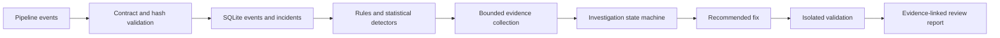

# DataOps architecture and integration contract

Status: design only.

## Components and state

The API and CLI accept bounded local events. SQLite stores deduplicated events, incidents, investigation steps, evidence indexes, and approval/validation records. A single-writer deployment is the initial target; production multi-user access and high availability are deferred.

States: observed -> triaged -> evidence-collected -> hypothesis-proposed -> candidate-prepared -> validation-completed -> awaiting-review. Alternatives include insufficient-evidence, invalid-input, budget-exhausted, and validation-failed. Every transition records its inputs, tool call, output hash, timing, and reason. Persist events before acknowledging ingestion; use transactions and event_id uniqueness for replay safety.

Monitoring combines explicit failure/quality/freshness rules with robust baseline comparisons for row counts and durations. Separate warm-up from healthy state; missing history yields insufficient-baseline, not invented certainty. Event-time and arrival-time are stored separately. Correlate incidents using run/task/dependency identifiers, not log wording alone.

Investigation tools read an approved evidence index, query bounded local telemetry, inspect approved code excerpts, and select relevant diagnostic tests. An optional model can propose hypotheses and structured recommendations. Deterministic diagnostics remain usable without a model. No paid provider or model inference is implemented.

## Contract compatibility

Canonical source: MediFlow `contracts/pipeline-event.schema.json`, version 1.0.0, ID `urn:mediflow-ai:pipeline-event:1.0.0`. This document intentionally avoids a sibling-file link so exported docs stay valid. Before standalone integration tests, vendor an approved snapshot and provenance hash; none is copied in Phase 1.

Required envelope fields: schema_version, event_id, run_id, pipeline_id, task_id, sequence, occurred_at, status, synthetic, metrics, quality, evidence. Status values are started, succeeded, failed, quarantined. Failed/quarantined events require error. No error is allowed on other statuses. Metrics are rows_read, rows_written, rows_rejected, duration_ms; quality has checks_total and checks_failed. Evidence items have kind, path, sha256. Reject unknown contract versions rather than silently coercing them. Breaking changes require a new major version and migration tests.

Validate JSON formats explicitly, payload limit of 64 KiB, counter consistency, allowed evidence paths, and actual evidence hash. Resolve evidence only under the approved run root; never fetch a URL supplied in an event. Deduplicate event IDs and handle out-of-order per-task sequences. Contradictory terminal states produce a contract incident.

## Fix validation and demonstrations

Candidates include hypothesis, evidence references, affected files, proposed diff, expected outcome, selected tests, and limitations. Validate only in an approved isolated execution boundary. If sandbox/network controls are unavailable, generate the recommendation and report validation blocked. Do not claim tests of a proposed patch ran safely when isolation is unverified.

Package healthy, schema-drift, duplicate-input, source-staleness, transformation-regression, and malicious-log scenarios later. Every replay exposes its seed, fixture version, and recorded status. Independent demos must not require MediFlow installation, AWS, internet, or a model unless explicitly labeled and approved.
